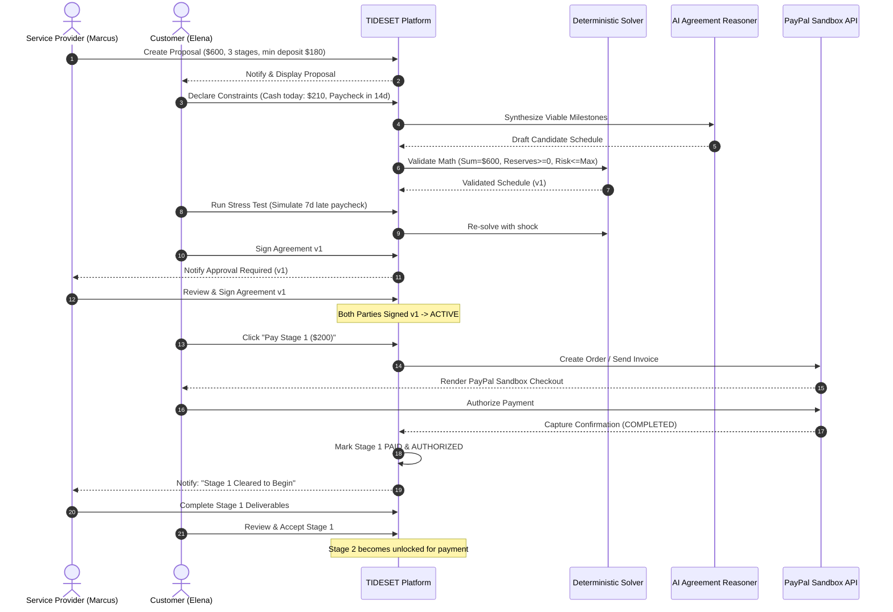
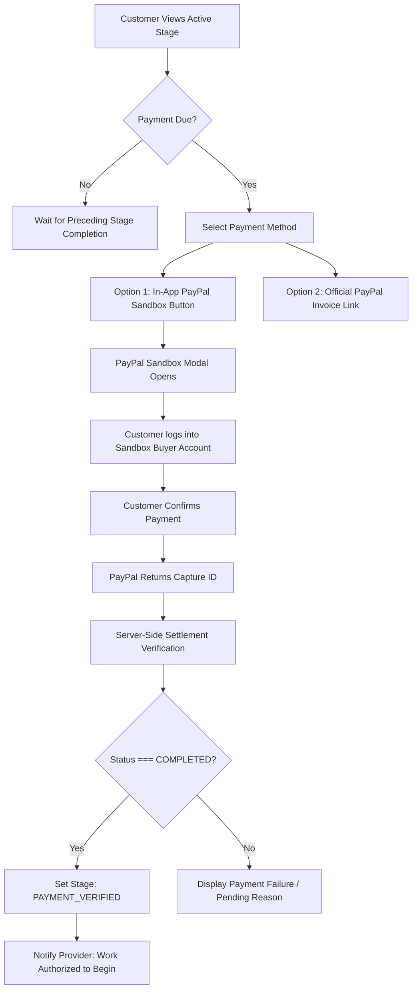
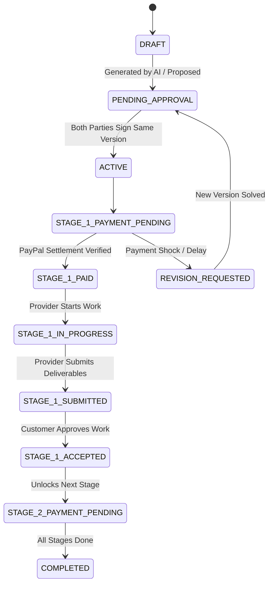

# TIDESET — AI Agreement Intelligence
## 02 — Workflows & User Journeys

**Version:** 1.0.0  
**Status:** Approved Architecture Draft  

---

## 1. End-to-End Lifecycle Architecture

TIDESET coordinates two distinct parties across five chronological states:
1. **Intake & Constraint Discovery**
2. **AI Synthesis & Deterministic Solving**
3. **Stress Testing & Counter-Proposals**
4. **Bilateral Mutual Ratification (Versioning)**
5. **Authoritative PayPal Settlement & Milestone Execution**

---

## 2. Customer Workflows

### 2.1 Customer Intake & Agreement Generation
1. **Entry Point:** Customer lands on TIDESET or opens a direct proposal link sent by a Service Provider.
2. **Onboarding / Authentication:** 1-click Demo Sign-in as "Elena (Customer)" or secure magic-link / credential session.
3. **Constraint Input:**
   - Available cash on hand today ($USD).
   - Expected incoming cash events (Date + Expected Amount).
   - Core project need & delivery deadline.
   - Comfortable maximum disbursement per milestone.
4. **AI Generation:** TIDESET displays real-time animated solver states ("Analyzing cash flow curves...", "Checking merchant exposure bounds...", "Synthesizing milestone definitions...").
5. **Alternative Review:**
   - **Plan A (Recommended - Balanced Risk):** Optimized for low initial outlay while meeting provider deposit floors.
   - **Plan B (Fast-Track):** Slightly higher initial deposit, faster milestone release.
   - **Plan C (Extended Runway):** Smaller stages aligned with bi-weekly salary drops.
6. **Constraint Feedback:** If the customer's cash flow is mathematically incapable of meeting the provider's baseline deposit, the interface displays:  
   *`"No Feasible Agreement: Provider requires $180 minimum deposit to begin work, but current available liquidity is $120. Options: Increase initial allocation by $60 or adjust provider scope."`*

### 2.2 Customer Agreement Acceptance & Version Ratification
1. Customer selects a feasible schedule.
2. The agreement state moves to `PENDING_CUSTOMER_APPROVAL` -> Customer signs version `v1`.
3. If the Provider modifies terms, version increments to `v2` and Customer must re-verify.

### 2.3 Customer PayPal Sandbox Payment Journey

---

## 3. Service Provider Workflows

### 3.1 Proposal Creation & Parameter Guardrails
1. **Project Definition:** Title, scope summary, target delivery date.
2. **Financial Bounds:**
   - Total Contract Price (e.g. \$600.00).
   - Minimum Initial Deposit Requirement (e.g. \$180.00 or 30%).
   - Maximum Uncollateralized Exposure Limit (e.g. \$250.00 max work delivered ahead of payment).
3. **Stage Suggestions:** Provider can either specify explicit stages or let TIDESET's AI dynamically generate balanced stages based on customer constraints.

### 3.2 Milestone Delivery & Progress Governance

---

## 4. Agreement Stress-Test Simulator Workflow

The Stress-Test Simulator allows both parties to simulate real-world financial friction before signing or during an active contract:

### 4.1 Stress Scenarios
1. **Income Delay (+7d or +14d):**
   - *Scenario:* Customer's second paycheck is delayed by 10 days.
   - *Impact Analysis:* Stage 2 due date falls before customer cash arrives, dropping cash reserve into negative (-\$40).
   - *AI Survivability Proposal:* Extends Stage 1 delivery review window by 7 days; shifts Stage 2 start date to match verified deposit date; keeps total contract \$600 invariant.
2. **Missed Installment:**
   - *Scenario:* Customer unable to disburse Stage 2 funds on scheduled date.
   - *Action:* Automatic Work Freeze. Provider is not exposed to uncompensated labor.
   - *Recovery:* Automated reschedule proposal generated without penalty interest.
3. **Scope / Cost Modification (+15%):**
   - *Scenario:* Provider identifies \$90 in additional server configuration.
   - *Solver Response:* Redistributes the \$90 across future stages subject to customer liquidity caps. Requires mutual bilateral signature.

---

## 5. User Permission & Role Matrix

| Capability / Action | Anonymous / Guest | Customer (Elena) | Service Provider (Marcus) | Platform Admin |
| :--- | :---: | :---: | :---: | :---: |
| View Public Landing Page & Interactive Sandbox | ✅ | ✅ | ✅ | ✅ |
| Switch Demo Persona | ✅ | ✅ | ✅ | ✅ |
| Create Service Proposal | ❌ | ❌ | ✅ | ✅ |
| Declare Personal Cash Flow Constraints | ❌ | ✅ | ❌ | ✅ |
| Run Stress Test on Proposed Agreement | ❌ | ✅ | ✅ | ✅ |
| Sign / Ratify Specific Agreement Version | ❌ | ✅ (Own Agreement) | ✅ (Own Agreement) | ❌ |
| Execute PayPal Sandbox Payment | ❌ | ✅ (Own Agreement) | ❌ | ❌ |
| Mark Work Stage "Submitted / Delivered" | ❌ | ❌ | ✅ (Own Agreement) | ❌ |
| Accept Completed Work Stage | ❌ | ✅ (Own Agreement) | ❌ | ❌ |
| Reconcile PayPal Settlement from Webhook | ❌ | ❌ | ❌ | ✅ (Server-Side) |

---

## 6. Failure Modes, Edge Cases, and Recovery Paths

### 6.1 Desynchronized Signatures (Version Mismatch)
- **Problem:** Customer signs `v1`. Provider alters Stage 2 delivery date, creating `v2`. Customer accidentally attempts to activate based on `v1`.
- **System Safeguard:** Cryptographic hash and integer version checking (`agreement.version === input.version`). If mismatched, action is rejected with `409 Conflict: Agreement updated by provider. Please review revised terms (v2).`

### 6.2 Partial or Underpaid PayPal Transaction
- **Problem:** User attempts to manipulate client-side payload to capture \$20 instead of \$200.
- **System Safeguard:** Server-side verification strictly verifies `capture.amount.value === stage.amount` and `capture.amount.currency_code === stage.currency`. Any discrepancy marks the order `FLAGGED_AMOUNT_MISMATCH` and refuses stage activation.

### 6.3 Network Timeout During PayPal Checkout
- **Problem:** PayPal completes capture on server, but browser disconnects before frontend callback finishes.
- **System Safeguard:** The application includes an asynchronous payment status reconciler. When the user reopens the dashboard, TIDESET checks the PayPal Orders/Invoices API directly to restore verified truth.
