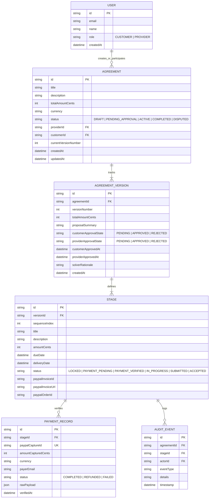

# TIDESET — AI Agreement Intelligence
## 03 — System Design & Technical Architecture

**Version:** 1.0.0  
**Status:** Approved Architecture Draft  

---

## 1. High-Level Architecture Overview

TIDESET is engineered as a secure, full-stack, modular Next.js application using the App Router, React 19, TypeScript, Tailwind CSS, Prisma ORM, and a decoupled engine architecture:

```
+---------------------------------------------------------------------------------------+
|                                    CLIENT LAYER                                       |
|                                                                                       |
|   +------------------------+  +------------------------+  +-----------------------+   |
|   |   Customer Dashboard   |  |   Provider Dashboard   |  | Stress-Test Sandbox   |   |
|   +------------------------+  +------------------------+  +-----------------------+   |
|   |                     Liquid Glass UI Component System                          |   |
|   |         (Tailwind CSS + Radix Primitives + Lucide Icons + Motion/React)       |   |
|   +-------------------------------------------------------------------------------+   |
|                                           |                                           |
|                                     HTTPS / JSON                                      |
+-------------------------------------------|-------------------------------------------+
                                            v
+---------------------------------------------------------------------------------------+
|                                  SERVER / API LAYER                                   |
|                                                                                       |
|  +-------------------------+  +------------------------+  +------------------------+  |
|  |  Agreement API Routes   |  |   PayPal Proxy Routes  |  |  Reconciliation Worker |  |
|  +-------------------------+  +------------------------+  +------------------------+  |
|                                           |                                           |
|        +----------------------------------+----------------------------------+        |
|        |                                  |                                  |        |
|        v                                  v                                  v        |
|  +-----------------------+      +-----------------------+      +-------------------+  |
|  |   AI Reasoner Adapter |      | Deterministic Solver  |      |   PayPal SDK      |  |
|  | (Structured JSON Gen) |      | (Constraint & Math)   |      | (Invoices & Orders|  |
|  +-----------------------+      +-----------------------+      +-------------------+  |
|                                           |                                  |        |
+-------------------------------------------|----------------------------------|--------+
                                            v                                  v
+------------------------------------------------------+  +-----------------------------+
|               DATABASE PERSISTENCE                   |  |    EXTERNAL SERVICES        |
|                                                      |  |                             |
|  Prisma ORM with SQLite (Local) / Postgres (Prod)    |  |  • PayPal Sandbox REST v2   |
|  - Users & Roles (Provider / Customer)               |  |  • Google Gemini / LLM API  |
|  - Agreements & Immutable Version Snapshots          |  |                             |
|  - Stages, Invoices & Verified Transaction Logs      |  +-----------------------------+
+------------------------------------------------------+
```

---

## 2. Database Schema & Data Models

We use Prisma with a relational model supporting SQLite for self-contained, reproducible hackathon execution and PostgreSQL for cloud deployment.



---

## 3. Financial Constraint Engine (Deterministic Solver)

The deterministic solver acts as an uncompromisable gatekeeper between the AI suggestions and the database:

### 3.1 Mathematical Invariants
1. **Conservation of Money:**
   $$\sum_{i=1}^{N} \text{amountCents}_i \equiv \text{totalAmountCents}$$
2. **Liquidity Non-Negativity:**
   At any time $t$, given initial buyer liquidity $L_0$ and discrete scheduled inflows $I(t)$:
   $$\text{Reserve}(t) = L_0 + \sum_{k: t_k \le t} I(t_k) - \sum_{j: \text{due}_j \le t} \text{amountCents}_j \ge 0$$
3. **Provider Exposure Bound:**
   At no point may work in progress exceed the provider's uncollateralized exposure limit $E_{\max}$:
   $$\text{StageAmount}_i \le E_{\max} \quad \forall i > 1$$
4. **Deposit Threshold:**
   $$\text{StageAmount}_1 \ge D_{\min}$$
5. **Chronological Monotonicity:**
   $$\text{DueDate}_1 \le \text{DeliveryDate}_1 \le \text{DueDate}_2 \le \text{DeliveryDate}_2 \le \dots \le \text{DeliveryDate}_N$$

If any invariant fails, the engine rejects the generated schedule and provides an exact diagnostic explanation.

---

## 4. AI Orchestration & Structured Schema Enforcement

The AI reasoner uses a strict JSON schema prompt to extract milestones and explain trade-offs:

```json
{
  "type": "object",
  "properties": {
    "summary": { "type": "string" },
    "stages": {
      "type": "array",
      "items": {
        "sequenceIndex": { "type": "integer" },
        "title": { "type": "string" },
        "description": { "type": "string" },
        "amountCents": { "type": "integer" },
        "daysFromStartDue": { "type": "integer" },
        "daysFromStartDelivery": { "type": "integer" }
      }
    },
    "tradeoffs": {
      "customerPerspective": { "type": "string" },
      "providerPerspective": { "type": "string" }
    },
    "feasibilityExplanation": { "type": "string" }
  },
  "required": ["summary", "stages", "tradeoffs", "feasibilityExplanation"]
}
```

The server pipeline:
1. Receive human constraints.
2. Formulate system prompt with strict bounding rules.
3. Call AI reasoning provider.
4. Pass raw structured output through the `DeterministicConstraintSolver`.
5. If invalid, the solver repairs or re-balances stage sums deterministically, flagging adjustments explicitly in `solverRationale`.

---

## 5. Authoritative PayPal Sandbox Integration

### 5.1 Architecture & Endpoints
TIDESET provides a dual-rail PayPal integration:

1. **PayPal Invoicing v2 Rail:**
   - Provider generates an official PayPal Invoice for Stage 1 or subsequent stages.
   - The platform sends the invoice via PayPal REST API.
   - Generates the official PayPal `payer_view_url` so the judge can view or pay on PayPal's hosted checkout.
2. **PayPal Smart Buttons (Orders v2) Rail:**
   - Embeds PayPal Checkout on the stage card.
   - `POST /api/paypal/orders/create`: Validates stage eligibility and creates an Order with exact `stage.amountCents`.
   - `POST /api/paypal/orders/capture`: Server captures the order and validates `status === 'COMPLETED'` directly with PayPal Sandbox before mutating stage state.

### 5.2 Payment Verification & Reconciler
```mermaid
flowchart TD
    A[Incoming Webhook or Manual Polling] --> B[Verify PayPal Signature]
    B -- Valid --> C[Extract Resource: invoice_id / capture_id]
    B -- Invalid / Tampered --> X[Reject with 401 Unauthorized]
    C --> D[Query PayPal Sandbox Directly: GET /v2/payments/captures/{id}]
    D --> E{Capture Status === COMPLETED?}
    E -- Yes --> F{Amount & Currency Match Stage Exactly?}
    F -- Yes --> G[Record PaymentRecord in DB with Idempotency Key]
    G --> H[Update Stage Status: PAYMENT_VERIFIED]
    H --> I[Unlock Stage Work Authorization]
    F -- No --> Y[Flag Fraudulent Amount Mismatch]
    E -- No --> Z[Record Pending/Failed State]
```

---

## 6. API Endpoint Contracts

| Method | Endpoint | Description | Auth Required |
| :--- | :--- | :--- | :--- |
| `GET` | `/api/auth/me` | Current demo persona or active session | None (Demo toggleable) |
| `POST` | `/api/agreements` | Create initial proposal | Provider |
| `GET` | `/api/agreements/:id` | Fetch agreement with all version history | Customer / Provider |
| `POST` | `/api/agreements/:id/solve` | Trigger AI generation + Constraint solver | Customer / Provider |
| `POST` | `/api/agreements/:id/simulate`| Run counterfactual stress-test | Customer / Provider |
| `POST` | `/api/agreements/:id/approve` | Bilateral ratification of specific version | Customer / Provider |
| `POST` | `/api/paypal/invoices/create`| Generate PayPal Sandbox invoice for stage | Provider |
| `POST` | `/api/paypal/orders/create` | Create PayPal Order for immediate stage pay| Customer |
| `POST` | `/api/paypal/orders/capture`| Verify and capture payment server-side | Customer |
| `POST` | `/api/paypal/webhooks` | Asynchronous event listener | PayPal Signature |
| `POST` | `/api/stages/:id/deliver` | Mark deliverables submitted | Provider |
| `POST` | `/api/stages/:id/accept` | Accept delivered milestone | Customer |

---

## 7. Architecture Decision Records (ADRs)

- **ADR-01: Decimal Arithmetic via Minor Units (Cents)**  
  *Decision:* All currency amounts stored as 64-bit integers representing cents (e.g., \$600.00 = 60000).  
  *Justification:* Eliminates IEEE 754 floating-point inaccuracies completely.
- **ADR-02: Deterministic Solver Pre-eminence over LLM**  
  *Decision:* LLMs are strictly forbidden from committing financial totals to the database without deterministic validation.  
  *Justification:* Generative AI is prone to arithmetic drift and hallucinations. Financial software demands absolute mathematical certainty.
- **ADR-03: Immutable Agreement Versions**  
  *Decision:* Edits to an agreement do not overwrite in place; they spawn a new `AgreementVersion` record (v1 -> v2) requiring mutual ratification.  
  *Justification:* Prevents bait-and-switch modifications where one party approves terms that are subsequently altered.
- **ADR-04: Dual PayPal Integration (Invoicing v2 + Orders v2)**  
  *Decision:* Provide both full PayPal Invoicing and Smart Order Checkout.  
  *Justification:* Judges can either test instant interactive checkout or verify official business invoicing workflow.
